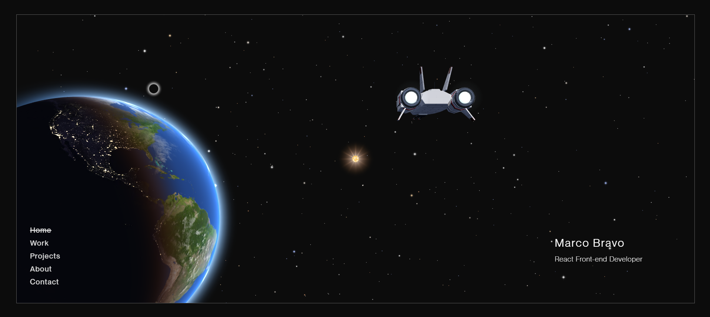
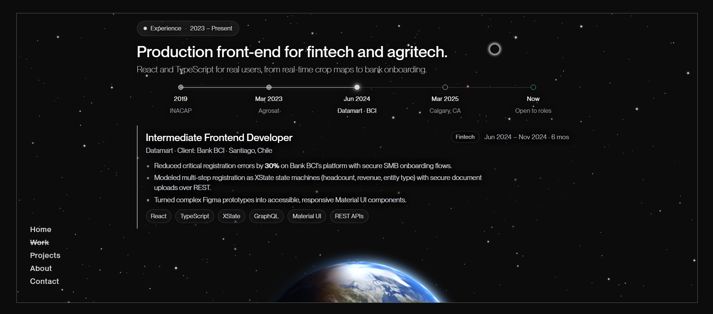
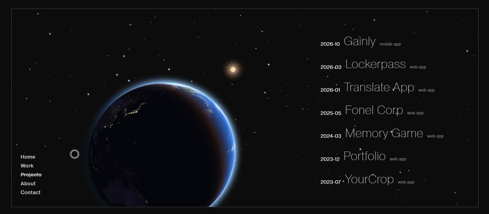

<div align="center">

# Marco Bravo — Interactive 3D Portfolio

**A cinematic, real-time 3D space scene that frames recruiter-first content — built with React, Three.js and hand-written GLSL shaders.**

[**Live Demo**](https://marcobc-exe.github.io/portfolio/) · [**Portfolio**](https://marcobc-exe.github.io/portfolio/) · [LinkedIn](https://www.linkedin.com/in/marcoabc/) · [GitHub](https://github.com/Marcobc-exe)




</div>

---

## Overview & Problem Solved

Most developer portfolios fall into one of two traps: a static template that looks like every other one, or a heavy 3D demo where the actual content gets lost. This project is built to avoid both. A single real-time WebGL scene — a sunlit Earth with city lights and clouds, a plasma sun, a twinkling starfield and a procedural spaceship — stays mounted behind every page, and **each route has its own camera pose**: navigating flies the camera on a smooth orbital arc while the content cross-fades in. The UX goal is that a technical recruiter gets the essentials in seconds (role, impact metrics, experience timeline, source code) while the scene does the storytelling, on any screen from a 320px phone to a 4K monitor, and without excluding users who prefer reduced motion or navigate by keyboard.

## Key Features & Technical Highlights

- **Hand-written GLSL shaders** for every celestial effect: an Earth surface with day map, night-side city lights, cloud shadows and a warm terminator; a separate cloud layer; a sunlit atmosphere rim; a plasma sun with a camera-facing corona; and a 6,500-point seeded starfield with temperature colors, per-star twinkle and diffraction spikes.
- **Procedural spaceship with zero model or texture files** — hulls lofted from hexagonal/octagonal cross-sections, panel lines injected into `MeshStandardMaterial` via `onBeforeCompile`, and reflections from a `RoomEnvironment` map generated at runtime with `PMREMGenerator`.
- **Route-driven camera choreography** — one pose per page (with landscape and portrait variants), eased over 1.6 s as orbital parameters so the camera always travels on an arc; a route change mid-flight continues from the current pose.
- **Page transitions synchronized with the camera** — the router renders a `displayedLocation` and a `leaving → entering` phase, so the old page fades out as the camera departs and the new one fades in as it arrives.
- **Accessible horizontal experience timeline** — implemented as a WAI-ARIA tabs widget (`role="tablist"`, roving `tabIndex`, Arrow / Home / End keys) with a data-driven detail panel; on phones the track scrolls sideways and keeps the active stop centered.
- **Reduced-motion support end to end** — `prefers-reduced-motion` freezes Earth rotation, star twinkle, shooting stars, the sun and the ship, makes the camera jump instead of fly, and disables CSS animations.
- **Responsive layout** — a bordered CSS-grid frame where each page aligns itself; on phones and short landscape screens the navigation becomes a centered bottom row, and the vertical FOV widens on narrow aspect ratios to preserve the desktop framing.
- **Frame-rate independent animation** — all motion uses `useFrame` deltas, and per-frame state lives in refs so the render loop never triggers React re-renders.
- **Performance-minded details** — a custom cursor moved with `transform: translate3d` (no layout), a single reused shooting-star mesh, and compressed WebP textures for clouds and night lights.
- **Content as data** — experience and projects live in `src/constants/` (`experience.js`, `projects.js`), so updating the CV means editing an array, not JSX.
- **Dev-only 3D inspection route** — `#/hangar` renders the spaceship alone with orbit controls, preset views, wireframe and PNG export; it is lazy-loaded behind `import.meta.env.DEV`, so it never ships to production.

## Tech Stack & Architecture

| Layer | Technology | Why |
| --- | --- | --- |
| Core | **React 18** + **Vite 5** | Component model for the pages; Vite for instant HMR and fast, small production builds. |
| 3D rendering | **Three.js r160** + **React Three Fiber 8** | Declarative scene graph in React, with direct access to the render loop (`useFrame`) and WebGL renderer when needed. |
| Graphics | **GLSL** (via `vite-plugin-string`) | Full control over lighting and atmosphere at a fraction of the cost of texture-heavy assets. |
| UI & Styling | **MUI 5**, per-component CSS, styled-components | MUI primitives and icons; plain CSS for layout and media queries; one styled router link. |
| Routing | **React Router 6** (`HashRouter`) | Client-side routing that works on GitHub Pages without server rewrites. |
| State | React Context (`CursorContext`) | The only global state is the custom cursor's hover mode and the active route — no store needed. |
| Tooling & Deploy | ESLint (0 warnings allowed), `gh-pages` | Lint-clean codebase; one-command deploy to GitHub Pages. |

```text
src/
├── components/
│   ├── Canvas3D/            # The persistent WebGL scene
│   │   ├── scene.js         # Single source of truth: camera poses, sun, ship placement
│   │   ├── CameraRig/       # Eases the camera between per-route poses
│   │   ├── Earth/  Sun/  Starfield/  ShootingStars/
│   │   ├── Spaceship/       # Loft geometry, procedural materials, runtime env map
│   │   └── shaders/         # *.glsl vertex/fragment shaders
│   ├── Layout/              # Bordered grid frame + page transition phases
│   ├── Navbar/  CursorPro/  Email/  Internet/
├── Pages/                   # Home · Work · Projects · About · Contact (+ dev-only Hangar)
├── constants/               # experience.js, projects.js, menu paths, URLs
├── context/                 # CursorContext
└── routes/AppRouter.jsx     # Routes + transition orchestration
```

## Engineering Decisions & Challenges

**1. Camera poses as orbital parameters, not positions.**
Interpolating raw camera positions between pages cuts straight through the planet and makes framing unpredictable across screen sizes. Instead, each pose is described as `{ azimuth, elevation, distance }` (where the camera orbits) plus `{ yaw, pitch, zoom }` (how it turns away from the Earth). Interpolating those numbers makes every transition an arc around the globe, and decouples *where the Earth sits on screen* (distance / yaw / pitch) from *which side of it you see* (azimuth / elevation) — so a new page can reuse a proven composition while showing a different hemisphere. Portrait variants and an aspect-aware FOV keep the composition intact on phones.

**2. Detailed 3D without shipping 3D assets.**
The spaceship is generated entirely in code: cross-sections are lofted into faceted hulls, and instead of writing custom materials from scratch, panel lines are injected into Three.js's physically based `MeshStandardMaterial` through `onBeforeCompile` — keeping its physically based lighting and environment reflections. The reflections come from a `RoomEnvironment` rendered to a PMREM map at startup, so the ship looks metallic with no HDR file to download. Lit materials are used only on the ship, so its lights never interfere with the shader-driven Earth, sun and stars.

**3. A motion-heavy site that stays accessible and legible.**
Every animated system checks `prefers-reduced-motion` and has a static path (including camera jumps instead of flights). Text over the planet's glow uses dark, blurred glass panels with a `@supports` fallback, and the experience timeline follows the WAI-ARIA tabs pattern so it is fully keyboard- and screen-reader-operable.

## Getting Started

**Prerequisites:** Node.js 18+ and npm.

```bash
# 1. Clone the repository
git clone https://github.com/Marcobc-exe/portfolio.git
cd portfolio

# 2. Install dependencies
npm install

# 3. Start the dev server
npm start
```

Open **http://localhost:5173/portfolio/** (the app is served under the `/portfolio/` base path used on GitHub Pages).
In development you can also open **http://localhost:5173/portfolio/#/hangar** to inspect the spaceship.

**Environment variables:** none required — the app is fully static and has no API keys or backend.

| Script | Description |
| --- | --- |
| `npm start` | Start the Vite dev server with HMR |
| `npm run build` | Production build to `dist/` |
| `npm run preview` | Serve the production build locally |
| `npm run lint` | ESLint with zero warnings allowed |
| `npm run deploy` | Build and publish `dist/` to the `gh-pages` branch |

## Screenshots

| Work — experience timeline | Projects — GitHub repositories |
| --- | --- |
|  |  |

---

## Author & Contact

**Marco Bravo** — Front-End Developer (React, Next.js, TypeScript) with Full-Stack capabilities (Python, FastAPI, PostgreSQL).
📍 Santiago, Chile · Working EST/CST hours · Bilingual (English / Spanish)

I'm open to Front-End and Full-Stack opportunities with international teams. Explore more projects and my experience at **[marcobc-exe.github.io/portfolio](https://marcobc-exe.github.io/portfolio/)**, or reach out directly:

[](https://marcobc-exe.github.io/portfolio/)
[](https://www.linkedin.com/in/marcoabc/)
[](https://github.com/Marcobc-exe)
[](mailto:marco.bravo.dev@gmail.com)
